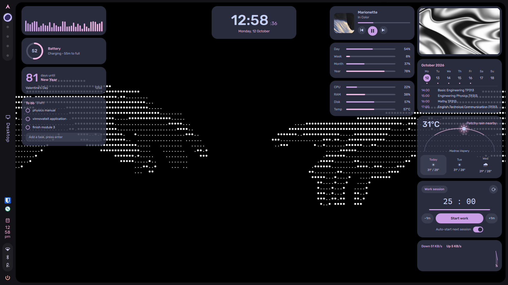
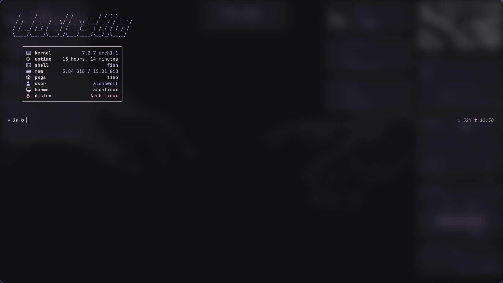
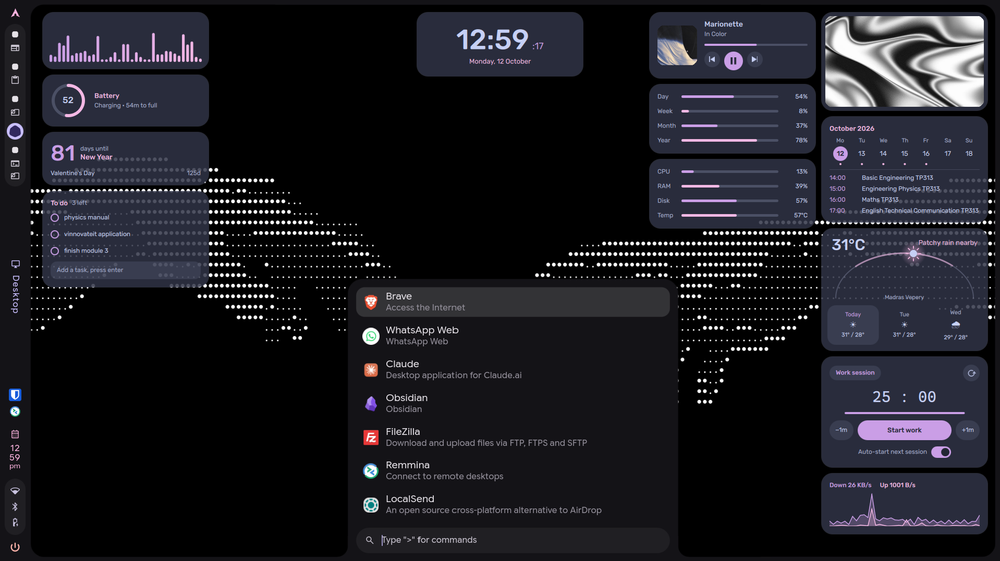
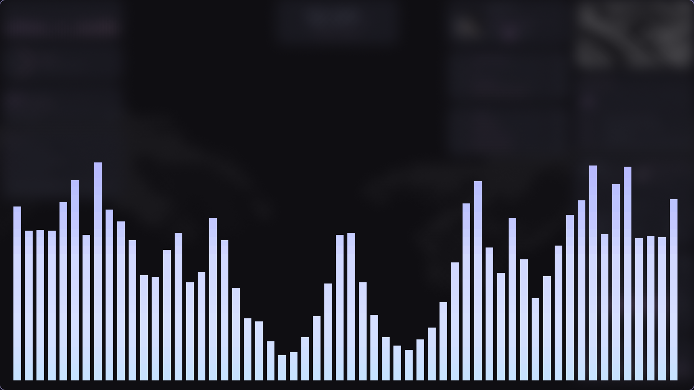
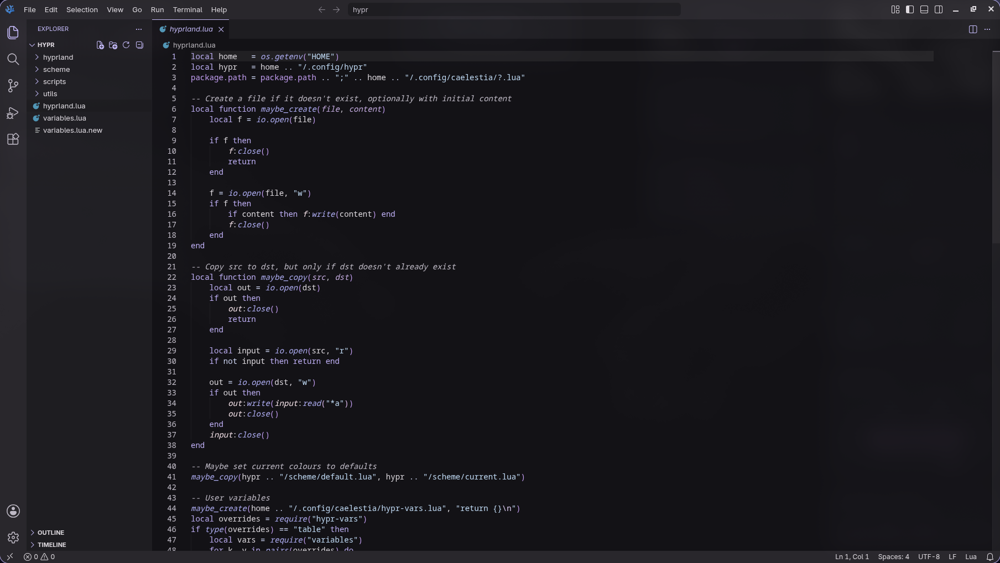

# mydots

My Linux dotfiles: a [Hyprland](https://hyprland.org/) desktop running the [Caelestia](https://github.com/caelestia-dots/shell) shell, plus the terminal tools and app themes I use every day.

> **Note:** This setup is [Caelestia](https://github.com/caelestia-dots/shell) with only minor changes of my own, mainly to keybinds, `exec` autostarts and a few other small tweaks. The look and feel, and most of the work, belong to the Caelestia project. If you want this desktop, start with Caelestia itself and use these files as a reference for my adjustments.

I also run my own [Quickshell](https://quickshell.org/) widgets alongside it, built by me and kept in a separate repo: **[alon3wolfus/qt-widgets](https://github.com/alon3wolfus/qt-widgets)**. They are not part of this repo, so install them from there.

## Screenshots



| | |
| --- | --- |
|  |  |
|  |  |

## What's inside

Each folder matches a directory in `~/.config/`.

| Folder | What it configures |
| --- | --- |
| `hypr` | Hyprland window manager |
| `caelestia` | Caelestia shell (bar, launcher, notifications) |
| `kitty`, `foot` | Terminal emulators |
| `fish` | Fish shell |
| `btop`, `htop` | System monitors |
| `fastfetch`, `fetch` | System info fetchers |
| `cava` | Audio visualizer (including custom shaders) |
| `rmpc` | MPD music client |
| `lazygit` | Git terminal UI |
| `spicetify` | Spotify theming |
| `swappy` | Screenshot annotation |
| `Thunar` | File manager |
| `BetterDiscord` | Discord themes only |
| `VSCodium` | Editor settings, keybindings and snippets only |

## What's not included

Some apps store login tokens and session data in their config folders, so they are left out on purpose: Todoist, Equibop/Equicord, OnlyOffice, and the internals of VSCodium and BetterDiscord (plugins, caches, history). Never commit those to a public repo.

## Install

Install Caelestia first by following its own instructions, then apply these files on top. Clone the repo, then symlink the folders you want into `~/.config`:

```bash
git clone https://github.com/alon3wolfus/mydots.git ~/mydots
cd ~/mydots

for dir in hypr caelestia kitty foot fish btop htop fastfetch fetch cava rmpc lazygit spicetify swappy Thunar; do
  [ -e ~/.config/"$dir" ] && mv ~/.config/"$dir" ~/.config/"$dir".bak   # back up what's there
  ln -s ~/mydots/"$dir" ~/.config/"$dir"
done
```

Remove folders from the list if you only want some of them. Existing configs are renamed to `<name>.bak` rather than overwritten.

For VSCodium, copy the files rather than linking the whole folder:

```bash
cp ~/mydots/VSCodium/User/{settings.json,keybindings.json} ~/.config/VSCodium/User/
cp -r ~/mydots/VSCodium/User/snippets ~/.config/VSCodium/User/
```

## Dependencies

Install the programs for the configs you use (Hyprland, the Caelestia shell, kitty, fish, and so on). Package names vary by distro, so check your package manager.

## Credits

- [Caelestia](https://github.com/caelestia-dots/shell) for the shell and base configuration. My changes are small tweaks on top of it.
- [alon3wolfus/qt-widgets](https://github.com/alon3wolfus/qt-widgets): my own Quickshell widgets, used alongside Caelestia.
- The `cava/shaders/orion_*` files are by their original author and keep their license headers.

## Notes

These are personal configs. They work on my machine and may need tweaking on yours, so read before you copy.
